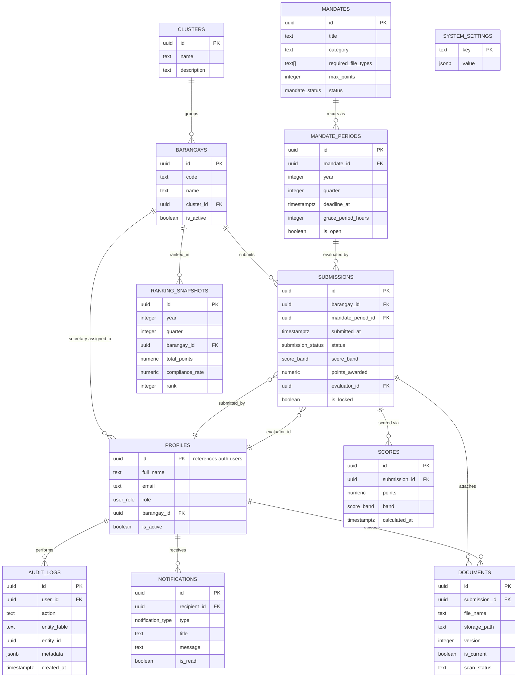

# Database Entity-Relationship Diagram

Rendered as Mermaid — paste into https://mermaid.live or view directly in any
Markdown renderer that supports Mermaid (GitHub, GitLab, Obsidian, etc.).

## Enum Reference

| Enum | Values |
|---|---|
| `user_role` | Active application roles: super_admin, barangay_secretary. Legacy enum labels remain for historical migration compatibility. |
| `submission_status` | pending, under_review, approved, rejected, missing, correction_requested |
| `score_band` | on_time, grace_period, late, rejected, missing |
| `mandate_status` | active, archived, draft |
| `notification_type` | submission_received, submission_approved, submission_rejected, correction_requested, deadline_approaching, deadline_passed, evaluation_completed, system |

## Key Constraints

- `submissions` has a unique constraint on `(barangay_id, mandate_period_id)` —
  one submission per barangay per mandate period, with a version history
  captured through the `documents.version` field and the `scores` audit trail
  rather than duplicate submission rows.
- `profiles` enforces `barangay_id is not null` whenever `role =
  'barangay_secretary'` via a CHECK constraint.
- `ranking_snapshots` and `mv_barangay_performance` are derived/denormalized
  tables — never edited directly, always regenerated from `submissions`.

See `supabase/migrations/0001_init_schema.sql` for the authoritative, fully
commented schema.
